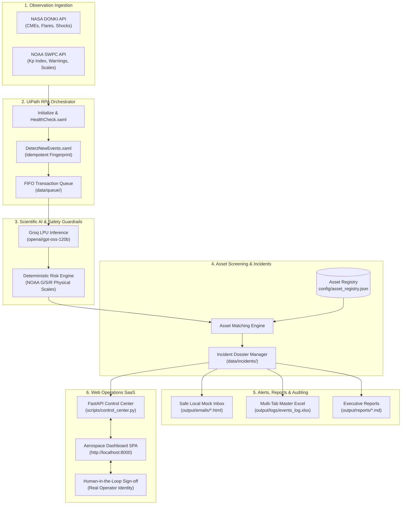

# SolarSentinel 🛰️☀️

[](https://opensource.org/licenses/MIT)
[](https://www.python.org/)
[](https://www.uipath.com/)
[-green.svg)](https://groq.com/)
[](https://fastapi.tiangolo.com/)
[](http://localhost:8000)

> **Enterprise Space Weather Defense & Autonomous RPA Operations Platform**  
> *Continuous Solar Telemetry Ingestion, Groq-Accelerated Scientific AI, Deterministic Risk Guardrails, Asset Screening, and Human-in-the-Loop Incident Mitigation.*

---

## 🧭 Executive Overview

**SolarSentinel** is a production-grade, end-to-end Space Weather Operations and Robotic Process Automation (RPA) SaaS platform. Space weather events—including Coronal Mass Ejections (CMEs), solar radiation storms, and geomagnetic disturbances—pose catastrophic risks to orbital spacecraft, terrestrial high-voltage electrical grids, transpolar commercial aviation, and global navigation systems.

SolarSentinel continuously bridges the gap between raw scientific observational data and actionable operations defense. It streams live solar telemetry from **NASA DONKI** and real-time planetary geomagnetic disturbance feeds from **NOAA Space Weather Prediction Center (SWPC)**, synthesizes physics-grounded assessments via the **Groq LPU-accelerated `openai/gpt-oss-120b`** model, enforces hard deterministic safety boundaries, cross-references threats against a registered infrastructure inventory, and orchestrates remediation workflows through **UiPath Studio** with verifiable **Human-in-the-Loop (HITL)** authorizations.

---

## 🌟 Key Features

### 🌐 Unified Operations SaaS Platform
- **Landing & Product Homepage**: High-impact aerospace presentation detailing the 4 core infrastructure threats (LEO Drag, GEO Deep Dielectric Discharge, Ground Grid GIC, Transpolar Radiation) and the 6-stage defense architecture.
- **Dark-Mode Glassmorphism Dashboard**: Ultra-clean interface with live Starfield background, ambient status glow, live telemetry tickers, and instant multi-view navigation.
- **Interactive Telemetry Monitors**: Real-time status indicators for NASA DONKI, NOAA SWPC, Groq LPU inference, and UiPath RPA transactional queue workers.

### 🔐 Google Auth & Signed Operator RBAC
- **Google Workspace Sign-In**: Enterprise-style single sign-on modal for mission personnel.
- **Operator Role Switcher**: Granular role-based identity switching (`Flight Director`, `Space Weather Analyst`, `Grid Reliability Coordinator`, `Satellite Fleet Operator`).
- **Cryptographic Audit Trail**: Incident authorizations explicitly record the authenticated operator's real name, role, UTC timestamp, and directive notes—eliminating anonymous or hardcoded mock approvals.

### 🚀 Live Pipeline Conductor
- **In-Browser Pipeline Trigger**: Execute the end-to-end 9-step ingestion, AI reasoning, and reporting sequence directly from the top navigation bar.
- **Real-Time Step Progression**: Visual 9-stage checklist with streaming execution badges and auto-updating completion percentages.
- **Live Terminal Telemetry**: Streaming log output showing exact NASA/NOAA API payloads, Groq token rates, and file generation metrics.

### 🤖 UiPath Robotic Process Automation (RPA)
- **Native XAML Orchestrator Workflows**: Modular architecture built for UiPath Studio (`Main.xaml`, `HealthCheck.xaml`, `CollectSpaceWeatherData.xaml`, `DetectNewEvents.xaml`, `ProcessTransactions.xaml`, `MatchAssets.xaml`, `CreateIncident.xaml`, `SendNotifications.xaml`, `HandleApproval.xaml`, `FinalizeRun.xaml`).
- **Persistent FIFO Transaction Queue**: Directory-backed local queue (`data/queue/pending`, `in_progress`, `completed`, `failed`) replicating enterprise UiPath Orchestrator queue semantics locally.
- **Idempotency Verification**: SHA-256 event fingerprinting guarantees zero duplicate queue items or alert storms upon repeated executions against identical observation windows.

### 🧠 Groq-Accelerated Scientific AI Reasoning
- **Open-Weight MoE Architecture**: Powered by `openai/gpt-oss-120b` via Groq LPUs delivering ultra-low-latency (~500 tokens/sec) astrophysical inference.
- **Kinematic Feature Extraction**: Extracts CME velocity, transit duration, angular width, and directional vectors to determine Earth-directed geoeffectiveness.
- **Structured JSON Synthesis**: Outputs machine-readable scientific assessments strictly validated against operational schemas.

### 🛡️ Deterministic Physical Safety Guardrails
- **Zero-Hallucination Fallback**: Hard physical rules override AI predictions when parameters breach safety limits (e.g., $v \ge 1200\text{ km/s}$ forces `CRITICAL` escalation regardless of LLM confidence).
- **Official NOAA Scale Mapping**: Maps parameters directly to standard NOAA Space Weather Scales:
  - **G1–G5**: Geomagnetic Storms (Power grid fluctuations, transformer damage, aurora).
  - **S1–S5**: Solar Radiation Storms (Biological satellite SEUs, high-latitude passenger exposure).
  - **R1–R5**: Radio Blackouts (HF communication fadeouts, radar degradation).

### 🛰️ Operational Infrastructure Protection Matrix
- **Critical Asset Registry (`config/asset_registry.json`)**: Protects real-world operational domains:
  - **Aegis-1 LEO Constellation**: Thermospheric neutral density surge, atmospheric drag, surface charging.
  - **Celestia-4 GEO Satcom**: Relativistic electron deep dielectric discharge ($E > 2\text{ MeV}$), star tracker blindness.
  - **Laurentian 735 kV Northern Grid**: Geomagnetically Induced Currents (GIC), transformer half-cycle saturation.
  - **Transpolar Flight Corridor Polar-1**: Polar Cap Absorption (PCA) HF radio blackout, flight rerouting.
  - **Radio Astronomy Array**: Solar radio bursts, ionospheric scintillation phase degradation.
- **Dynamic Asset Onboarding**: Modal-driven onboarding to register new satellites, grids, or corridors directly into the live monitoring registry.

### 🧪 What-If Space Weather Simulation Sandbox
- **Parametric CME Modeler**: Interactive sliders to adjust plasma speed (300–3,000 km/s), Kp index (0–9), and trajectory angles.
- **Real-Time Physics Calculator**: Instant Sun-to-Earth transit duration calculation ($t = 1\text{ AU} / v$) and immediate asset vulnerability screening.
- **Sandbox Incident Dispatcher**: One-click dispatch of simulated scenarios into the live operational incident feed with strict `IS_SIMULATED: TRUE` isolation.

### 📥 Reports & Downloads Center
- **One-Click File Downloads**: Instant browser downloading of generated Excel workbooks (`.xlsx`), event audit tables (`.csv`), executive briefing dossiers (`.md`), and HTML alert emails (`.html`).
- **Interactive In-Browser Viewer**: Built-in modal previewer rendering Markdown dossiers, isolated HTML email iframes, and raw JSON transaction records.

---

## 🏛️ System Architecture



---

## 🧩 UiPath RPA Workflow Architecture

| Workflow File | Type | Purpose & Orchestration Role |
|:---|:---|:---|
| [`Main.xaml`](file:///c:/Users/Devraj/SolarSentinel/uipath/SolarSentinel/Main.xaml) | Sequence | Master orchestrator with root TryCatch error boundary and state machine. |
| [`Initialize.xaml`](file:///c:/Users/Devraj/SolarSentinel/uipath/SolarSentinel/Initialize.xaml) | Sequence | Loads configuration, verifies environment, and computes UTC monitoring windows. |
| [`HealthCheck.xaml`](file:///c:/Users/Devraj/SolarSentinel/uipath/SolarSentinel/HealthCheck.xaml) | Sequence | Probes NASA, NOAA, and Groq API connectivity before processing. |
| [`CollectSpaceWeatherData.xaml`](file:///c:/Users/Devraj/SolarSentinel/uipath/SolarSentinel/CollectSpaceWeatherData.xaml) | Sequence | Resilient HTTP ingestion layer with exponential backoff and retries. |
| [`DetectNewEvents.xaml`](file:///c:/Users/Devraj/SolarSentinel/uipath/SolarSentinel/DetectNewEvents.xaml) | Sequence | Checksum-based deduplication verifying incoming CMEs against state store. |
| [`ProcessTransactions.xaml`](file:///c:/Users/Devraj/SolarSentinel/uipath/SolarSentinel/ProcessTransactions.xaml) | Sequence | Transactional loop executing per-event analysis and asset screening. |
| [`MatchAssets.xaml`](file:///c:/Users/Devraj/SolarSentinel/uipath/SolarSentinel/MatchAssets.xaml) | Sequence | Cross-references normalized threats against operational infrastructure. |
| [`CreateIncident.xaml`](file:///c:/Users/Devraj/SolarSentinel/uipath/SolarSentinel/CreateIncident.xaml) | Sequence | Formats and persists structured incident dossiers in `data/incidents/`. |
| [`SendNotifications.xaml`](file:///c:/Users/Devraj/SolarSentinel/uipath/SolarSentinel/SendNotifications.xaml) | Sequence | Dispatches styled HTML briefings to mock inbox or SMTP server. |
| [`HandleApproval.xaml`](file:///c:/Users/Devraj/SolarSentinel/uipath/SolarSentinel/HandleApproval.xaml) | Flowchart | Human-in-the-loop approval gate for High and Critical severity incidents. |
| [`FinalizeRun.xaml`](file:///c:/Users/Devraj/SolarSentinel/uipath/SolarSentinel/FinalizeRun.xaml) | Sequence | Commits operational metrics to `monitor_state.json` and writes Excel logs. |

---

## 🛠️ Technology Stack

| Layer | Technologies | Role in Platform |
|:---|:---|:---|
| **Operations SaaS UI** | HTML5, Vanilla Modern CSS, JavaScript (ES6+), Inter & JetBrains Mono | Responsive dark-mode aerospace dashboard with canvas starfield and modals |
| **Backend & REST API** | Python 3.10+, FastAPI, Uvicorn, Pydantic | Asynchronous control center, live pipeline streaming runner, and file server |
| **Robotic Process Automation** | UiPath Studio (Windows, Modern), UiPath.System.Activities | Orchestrator workflows, transactional loops, and enterprise state engine |
| **Scientific AI Reasoning** | `openai/gpt-oss-120b` via Groq LPU | High-throughput (~500 tps) astrophysical reasoning and kinematic parsing |
| **Deterministic Risk Engine** | Python Physical Rules Engine | NOAA G/S/R multi-scale classification and hard boundary guardrails |
| **Reporting & Data Export** | OpenPyXL, Pandas, Markdown | Multi-tab styled Excel workbooks, CSV tables, and Markdown briefing dossiers |

---

## 🚀 Quickstart Guide

### 1. Clone & Set Up Virtual Environment

```bash
# Clone repository
git clone https://github.com/Devrajj-Singh/SolarSentinel.git
cd SolarSentinel

# Create and activate Python virtual environment
python -m venv venv
.\venv\Scripts\activate       # On Windows PowerShell
# source venv/bin/activate     # On macOS/Linux

# Install all dependencies
pip install -r requirements.txt
```

### 2. Configure Credentials

```bash
# Copy example configuration template
cp config/settings.example.json config/settings.json
```

Edit `config/settings.json` to insert your Groq API key and optional NASA/SMTP credentials:
```json
{
  "groq": {
    "api_key": "gsk_your_groq_api_key_here",
    "model": "openai/gpt-oss-120b"
  },
  "nasa": {
    "api_key": "DEMO_KEY"
  }
}
```
*(Note: `config/settings.json` is protected by `.gitignore` and never committed).*

### 3. Launch the Operations SaaS Platform

```bash
python scripts/control_center.py
```

Open your browser to:
- **Operations Control Center**: [http://localhost:8000](http://localhost:8000)
- **Interactive OpenAPI Documentation**: [http://localhost:8000/docs](http://localhost:8000/docs)

### 4. Run the Autonomous Pipeline CLI

You can trigger the full pipeline either via the **"▶ Run Pipeline"** button in the Web UI or via CLI:
```bash
python scripts/run_pipeline.py
```

### 5. Run UiPath Studio Workflows

1. Open **UiPath Studio** (Windows modern profile).
2. Click **Open Project** and select `uipath/SolarSentinel/project.json`.
3. Open `Main.xaml` and click **Run** (or `F5`).
4. The workflow will execute pre-flight health checks, ingest telemetry, process transactions through the queue, screen registered assets, and write reports.

### 6. Run the College Demo Suite

SolarSentinel includes a zero-friction evaluation suite featuring 7 deterministic scenarios:
```bash
# Run a specific scenario (1 to 7)
python scripts/run_demo.py --scenario 3

# Run all scenarios sequentially
python scripts/run_demo.py --all
```
- **Scenario 1**: Quiet Baseline Monitoring (G0 conditions, zero false alarms).
- **Scenario 2**: Moderate Geomagnetic Storm (G2) (LEO aerodynamic drag mitigation).
- **Scenario 3**: Severe Solar Superstorm (G4/G5) (Critical Grid & GEO exposure, approval gate).
- **Scenario 4**: Idempotency Proof (Re-running identical stream produces 0 duplicates).
- **Scenario 5**: Cloudflare / API Fallback Resilience (Deterministic physical safety rules).
- **Scenario 6**: Human-in-the-Loop Sign-Off (Flight Director authorization flow).
- **Scenario 7**: What-If Carrington-Class Simulation Sandbox.

---

## 📡 REST API Reference

| Endpoint | Method | Description |
|:---|:---:|:---|
| `/` | `GET` | Serves the single-page aerospace Operations SaaS platform. |
| `/api/status` | `GET` | Returns real-time health for NASA, NOAA, Groq, and UiPath queue counts. |
| `/api/pipeline/run` | `POST` | Triggers the 9-stage operational pipeline in a background thread. |
| `/api/pipeline/status` | `GET` | Polls current pipeline execution progress %, active step, and streaming logs. |
| `/api/incidents` | `GET` | Lists all operational space weather incident dossiers. |
| `/api/incidents/{id}` | `GET` | Retrieves full JSON dossier for a specific incident. |
| `/api/incidents/{id}/approve` | `POST` | Authorizes an incident SOP; stamps operator name, role, notes, and timestamp. |
| `/api/incidents/{id}/reject` | `POST` | Rejects an incident SOP with operator rationale and timestamp. |
| `/api/assets` | `GET` | Returns list of all registered space and ground operational assets. |
| `/api/assets` | `POST` | Onboards a new satellite, power grid, or aviation corridor into registry. |
| `/api/reports` | `GET` | Scans and categorizes all available logs, reports, mock emails, and audit files. |
| `/api/reports/download/{cat}/{file}` | `GET` | Direct browser download of Excel (`.xlsx`), CSV, Markdown, or HTML files. |
| `/api/reports/preview/{cat}/{file}` | `GET` | Retrieves file content for the in-browser modal viewer. |
| `/api/simulate` | `POST` | Evaluates hypothetical CME parameters against asset registry in-memory. |
| `/api/simulate/dispatch` | `POST` | Dispatches a simulated scenario as an official sandbox incident dossier. |
| `/api/auth/login` | `POST` | Authenticates operator session profile (Google Workspace or custom role). |

---

## 📂 Repository Structure

```
SolarSentinel/
├── config/
│   ├── asset_registry.json         # Infrastructure registry (LEO, GEO, Grid, Polar)
│   ├── settings.example.json       # Sanitized configuration template
│   └── settings.json               # Active API credentials (git-ignored)
├── data/
│   ├── incidents/                  # Operational incident dossiers (INC-*.json)
│   ├── queue/                      # FIFO transactional queue
│   │   ├── pending/                # Awaiting execution
│   │   ├── in_progress/            # Active processing
│   │   ├── completed/              # Successfully processed transactions
│   │   └── failed/                 # Dead-letter / retry queue
│   ├── processed/                  # Normalized AI & risk assessment outputs
│   ├── raw/                        # Ingested NASA DONKI & NOAA SWPC feeds
│   ├── sample/                     # Pre-packaged versioned evaluation samples
│   └── state/                      # monitor_state.json operational tracking
├── output/
│   ├── audit/                      # Microsoft Teams / Slack webhook JSON payloads
│   ├── emails/                     # Safe Local Mock Inbox (aerospace HTML & TXT)
│   ├── logs/                       # Master Excel Log (events_log.xlsx) & CSV
│   └── reports/                    # Executive Markdown briefing reports
├── scripts/
│   ├── analyze_events.py           # GPT-OSS 120B AI scientific analysis (Groq)
│   ├── control_center.py           # FastAPI Control Center & embedded dashboard
│   ├── dashboard.html              # Modern dark-mode SaaS SPA interface
│   ├── fetch_noaa.py               # NOAA SWPC live geomagnetic data collector
│   ├── generate_reports.py         # Multi-sheet Excel & Markdown report engine
│   ├── incident_manager.py         # Space weather incident lifecycle controller
│   ├── match_assets.py             # Asset-aware vulnerability screening engine
│   ├── notify.py                   # Multi-channel notification dispatcher
│   ├── queue_manager.py            # Transaction queue & state store CLI/library
│   ├── risk_engine.py              # Deterministic multi-scale risk engine
│   ├── run_demo.py                 # Deterministic College Demo Suite (Scenarios 1-7)
│   └── run_pipeline.py             # End-to-end master autonomous pipeline
├── uipath/SolarSentinel/
│   ├── CollectSpaceWeatherData.xaml# Resilient NASA DONKI HTTP ingestion
│   ├── CreateIncident.xaml         # Incident creation workflow
│   ├── DetectNewEvents.xaml        # Idempotent deduplication check
│   ├── FinalizeRun.xaml            # State store persistence
│   ├── HandleApproval.xaml         # Human-in-the-loop approval gate
│   ├── HealthCheck.xaml            # Pre-flight diagnostic probe
│   ├── Initialize.xaml             # Configuration & UTC window initialization
│   ├── Main.xaml                   # Master orchestrator & TryCatch error boundary
│   ├── MatchAssets.xaml            # Operational asset matching workflow
│   ├── NormalizeEvents.xaml        # CME metric normalization
│   ├── ProcessTransactions.xaml    # Transaction item loop
│   ├── SendNotifications.xaml      # Multi-channel notification dispatch
│   └── project.json                # UiPath project configuration
├── docs/
│   ├── architecture.md             # V1 architectural specifications
│   └── v2_plan.md                  # SolarSentinel V2 master engineering plan
├── requirements.txt                # Python package dependencies
└── README.md                       # Comprehensive platform documentation
```

---

## 📊 Master Excel Log Structure (`events_log.xlsx`)

The generated Excel workbook (`output/logs/events_log.xlsx`) features three styled, frozen-header tabs:

1. **`CME Event Log`**: Ingested and normalized solar events, kinematic parameters, AI confidence scores, NOAA planetary Kp predictions, deterministic risk ratings, and physical rule triggers.
2. **`Asset Screening`**: Operational space and ground infrastructure matches, criticality tiers, impact statuses (`POTENTIALLY_AFFECTED`, `MONITORING_ADVISED`, `NOMINAL`), triggering factors, and specific Standard Operating Procedure (SOP) mitigation actions.
3. **`Incident Register`**: Official incident records, unique incident IDs, target event associations, assigned severities, real-time lifecycle statuses, and human-in-the-loop authorization states.

---

## ⚠️ Operational Safety Disclaimer

> **IMPORTANT**: SolarSentinel is an autonomous research, simulation, and decision-support platform designed to demonstrate the convergence of AI reasoning and Robotic Process Automation. It is **not** an operational space weather forecasting agency and must **never** be used for unsupervised physical control of satellites, power transmission grids, or life-critical aerospace systems. Operational decisions must always reference official space weather agencies such as the **NOAA Space Weather Prediction Center (SWPC)** and **ESA Space Situational Awareness (SSA)**.

---

## 📄 License

This project is licensed under the MIT License - see the [LICENSE](LICENSE) file for details.
